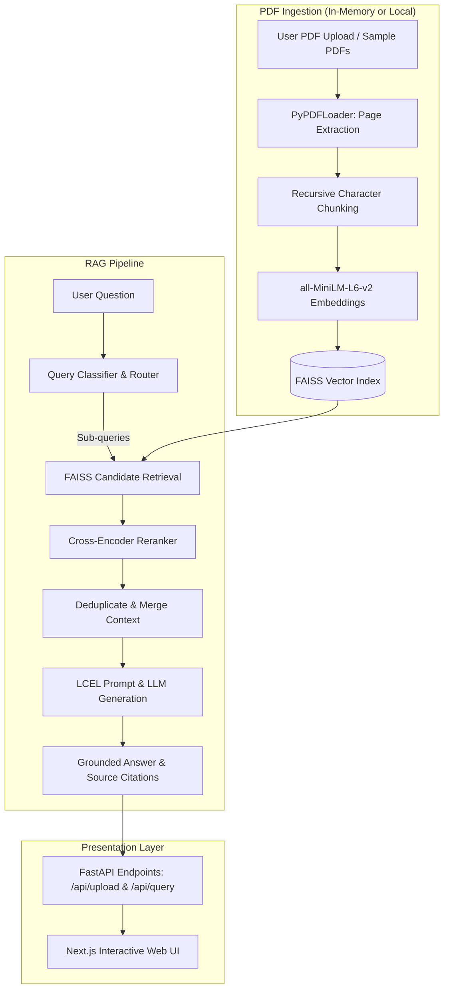

# HR Policy Bot — Agentic RAG Platform

**Selected domain:** HR Policy Bot — answering employee questions about leave, benefits, and workplace policies using sanitized HR policy documents and user-uploaded PDFs.

The application supports **interactive user PDF uploads** processed in-memory through the web interface, as well as a **pre-indexed knowledge base** of sanitized company HR policy documents for baseline evaluation and CLI testing.

> **Current status:** Full-stack pipeline implemented. End-to-end features include page-aware PDF extraction, recursive chunking, local embeddings, FAISS vector search, query classification & multi-part decomposition, cross-encoder reranking, LCEL generation via OpenRouter, a FastAPI REST service (`/api/upload`, `/api/query`, `/health`), an interactive Next.js source-attribution UI, and RAGAS evaluation tooling.

## Project overview

The system provides grounded answers from HR policy documents. When a user asks a question, the pipeline:
1. Classifies the query type (`single_fact`, `multi_part`, `summarization`) and decomposes multi-part questions into targeted sub-queries.
2. Retrieves candidate chunks from the FAISS vector store.
3. Reranks candidates against each sub-query using a cross-encoder model.
4. Synthesizes an answer via LangChain Expression Language (LCEL) and OpenRouter LLM.
5. Returns citations including source filenames, page numbers, chunk IDs, and text snippets.

## Architecture



## Technology stack

| Component | Technology | Purpose / status |
|---|---|---|
| Language & Runtime | Python 3.11 / Node.js 18+ | Backend and Frontend environments |
| Web UI | Next.js 15, React, TypeScript | Interactive frontend with live document upload, query input, and source attribution |
| Backend API | FastAPI, Uvicorn | REST endpoints: `GET /health`, `POST /api/upload`, `POST /api/query` |
| PDF Ingestion | LangChain `PyPDFLoader` | Page-aware extraction with source and zero-based page metadata |
| Chunking | `RecursiveCharacterTextSplitter` | Configured for 800 characters with 120-character overlap |
| Embeddings | `sentence-transformers/all-MiniLM-L6-v2` | 384-dimensional local dense embeddings |
| Vector Store | FAISS (Facebook AI Similarity Search) | In-memory indexing for session uploads; disk-persisted index for default policies |
| Query Routing | LLM JSON routing with rule fallback | Classifies single-fact, multi-part, and summarization queries |
| Reranking | `cross-encoder/ms-marco-MiniLM-L-6-v2` | Re-scores FAISS candidates for higher precision |
| Answer Generation | LangChain LCEL + `ChatOpenRouter` | OpenRouter model integration with citation formatting |
| Evaluation | RAGAS | Automated evaluation of faithfulness, answer relevancy, and context precision |

## Repository structure

```text
Agentic-AI-SDE-Project/
├── README.md                          # Main project documentation
├── pyrightconfig.json                 # Type checking & language server configuration
├── .python-version                    # Python runtime version for cloud deployment
├── requirements.txt                   # Root Python dependencies for cloud deployment
├── backend/
│   ├── README.md                      # Detailed backend guide & CLI commands
│   ├── requirements.txt               # Backend Python dependencies
│   ├── app/
│   │   ├── main.py                    # FastAPI application server
│   │   ├── ingestion/
│   │   │   ├── pdf_loader.py          # CLI loader for sample documents
│   │   │   ├── chunker.py             # Recursive text chunker
│   │   │   └── upload_processor.py    # In-memory upload processor & FAISS indexer
│   │   ├── retrieval/
│   │   │   ├── embeddings.py          # Local embeddings model
│   │   │   ├── faiss_store.py         # FAISS builder & persistence
│   │   │   ├── query_index.py         # FAISS query CLI
│   │   │   └── retrieval_checks.py    # Retrieval consistency tests
│   │   └── rag/
│   │       ├── main.py                # LCEL RAG chain
│   │       ├── query_router.py        # Question routing & sub-query generation
│   │       └── reranker.py            # Cross-encoder reranker
│   └── data/
│       └── index/
│           └── hr_policy_faiss/       # Saved FAISS index for sample documents
├── data/
│   └── documents/                     # Sample HR policy PDFs (bundled)
├── frontend/                          # Next.js web application
│   ├── app/
│   │   ├── page.tsx                   # Main chat & document interface
│   │   └── layout.tsx                 # Root layout & styling
│   └── package.json
├── evaluation/
│   ├── requirements.txt               # Offline evaluation dependencies (RAGAS, pandas)
│   ├── hr_eval_dataset.json           # Labeled evaluation test set
│   ├── run_ragas.py                   # Automated RAGAS evaluation runner
│   ├── reranking_comparison.json      # Reranking before/after experimental evidence
│   └── screenshots/                   # Terminal & evaluation screenshots
├── .env                               # Local secrets (never commit)
└── .gitignore
```

## PDF Handling: Do I need to save PDFs locally?

**No, you do not need to save PDFs locally.**

1. **Interactive Web App (`POST /api/upload`)**:
   - Any PDF you upload via the web interface is processed entirely **in memory**.
   - The backend uses a temporary working directory to extract pages via `upload_processor.py`, then immediately deletes the temporary file.
   - Text chunks and FAISS vectors are held in memory for the active browser session (`UPLOADS` cache).
   - Nothing is permanently stored on your hard drive.

2. **Default Sample Documents (`data/documents/`)**:
   - The repository already comes pre-bundled with sample HR policy PDFs under `data/documents/`:
     - `Veer_IT_Solutions_HR_Manual.pdf` (31 pages)
     - `Veer_IT_Solutions_India_Leave_Policy.pdf` (8 pages)
   - Their FAISS vector index is already built and saved in `backend/data/index/hr_policy_faiss/`.
   - You can test the default knowledge base immediately without downloading or saving any extra files.

## Setup & Running the Project

### 1. Environment Setup

Run all Python setup commands from the repository root:

```bash
python3 -m venv .venv
source .venv/bin/activate
python -m pip install -r backend/requirements.txt
```

Create a root `.env` file with your OpenRouter credentials:

```dotenv
OPENROUTER_API_KEY=your_openrouter_api_key
OPENROUTER_MODEL=nvidia/nemotron-3.5-lightning:free
```

### 2. Run the Backend API

From the repository root (with `.venv` active):

```bash
uvicorn backend.app.main:app --reload --port 8000
```
- API Health Check: `http://127.0.0.1:8000/health`
- Interactive Swagger Docs: `http://127.0.0.1:8000/docs`

### 3. Run the Frontend UI

From a separate terminal window:

```bash
cd frontend
npm install
npm run dev
```
Open [http://localhost:3000](http://localhost:3000) in your browser to interact with the full application.

---

## Standalone Pipeline Execution (CLI)

You can also run each stage of the pipeline independently from the command line:

```bash
# Ingestion and chunking verification
python -m backend.app.ingestion.pdf_loader
python -m backend.app.ingestion.chunker

# Vector store build and query
python -m backend.app.retrieval.embeddings
python -m backend.app.retrieval.faiss_store
python -m backend.app.retrieval.query_index
python -m backend.app.retrieval.retrieval_checks

# RAG chain with routing and cross-encoder reranking
python -m backend.app.rag.query_router
python -m backend.app.rag.reranker
python -m backend.app.rag.main

# Automated RAGAS evaluation
python -m evaluation.run_ragas
```

## Reranking evidence

The standalone reranker evaluates six HR questions and writes before/after rankings to `evaluation/reranking_comparison.json`. For “How many casual leaves are allocated on a half-yearly basis?”, FAISS initially ranked chunk 102 (page 1) first, while the cross-encoder ranked chunk 109 (page 3) first; chunk 109 contains the casual-leave allocation text.

The integrated `main.py` run also prints candidate rankings, scores, and `Top result changed` flags, verifying that reranked chunks directly inform the context sent to the LLM.

## Cloud Deployment (Vercel + Render)

The project is deployed across a decoupled full-stack architecture:

### 1. Frontend: Hosted on [Vercel](https://vercel.com)
- **Live URL:** `https://agentic-ai-sde-project.vercel.app`
- **Framework:** Next.js 15 (Turbopack)
- **Root Directory:** `frontend`
- **Build Command:** `npm run build`
- **Environment Variables:**
  - `NEXT_PUBLIC_HR_POLICY_API_URL`: `https://agentic-ai-sde-project.onrender.com`

### 2. Backend API: Hosted on [Render](https://render.com)
- **Live URL:** `https://agentic-ai-sde-project.onrender.com`
- **Runtime:** Python 3.11 (`.python-version`)
- **Build Command:** `pip install -r requirements.txt`
- **Start Command:** `uvicorn backend.app.main:app --host 0.0.0.0 --port $PORT`
- **Environment Variables:**
  - `OPENROUTER_API_KEY`: OpenRouter API key for LLM generation
  - `PYTHONPATH`: `.`
  - `FRONTEND_ORIGINS`: `https://agentic-ai-sde-project.vercel.app,http://localhost:3000`

---

## Verified progress

| Requirement | Status |
|---|---|
| Page-aware PDF extraction with source/page metadata | Verified (39 pages from 2 PDFs) |
| Recursive chunking and chunk IDs | Verified (124 chunks) |
| Local embeddings (384 dimensions) | Verified |
| FAISS index build and persistence | Verified |
| `query_index(question, k)` with L2 distances | Verified |
| Repeatability and question-sensitivity checks | Passed |
| LCEL answer-generation chain | Verified |
| Query decomposition and sub-query retrieval | Verified |
| LLM JSON routing with deterministic rule fallback | Verified |
| Cross-encoder reranking integration | Verified |
| FastAPI REST API (`/health`, `/api/upload`, `/api/query`) | Verified & active |
| In-memory PDF upload and session vector store | Verified & active |
| Interactive Next.js Frontend with source citations | Verified & active |
| RAGAS evaluation script (`evaluation/run_ragas.py`) | Implemented |
| Hosted deployment (Vercel Frontend + Render Backend) | Verified & active |
